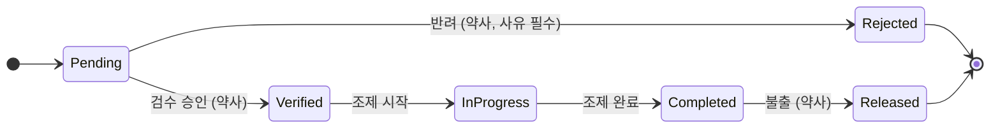

# 약제부 처방 검수·조제 워크플로우 API

병원 약제부의 **처방 접수 → 자동 검수 → 약사 승인 → 조제 → 불출** 흐름을 관리하는 백엔드 API입니다.
C# / ASP.NET Core로 만들었고, 모든 개발·테스트·실행을 Docker 컨테이너 안에서 합니다.

> **학습용 프로젝트입니다.** 실제 환자 정보를 사용하지 않으며, 약품 정보와 검수 규칙은 모두 가상의 샘플이라
> 실제 임상 판단이나 조제 업무를 대체할 수 없습니다.

## 주요 기능

- **상태 머신**: 허용된 전이만 통과시키고, 모든 전이를 감사 로그로 기록
- **자동 검수 규칙 엔진**: 1일 최대 용량, 병용 금기, 중복 성분, 미등록 약품 검사 (규칙 클래스 추가만으로 확장)
- **중대 경고 승인 정책**: 중대 경고가 있는 처방은 확인 사유가 있어야 승인되고, 사유는 감사 로그에 남음
- **JWT 인증 + 역할 기반 권한**: 처방의 / 약사 / 조제 보조 / 조회 전용
- **데이터 영속성**: EF Core + SQLite (Docker 볼륨), 상태 변경과 이력을 한 트랜잭션으로 저장, 동시 수정 충돌 감지
- **표준 오류 응답**: 모든 오류가 `code`와 `traceId`를 포함한 `application/problem+json`

## 상태 흐름



| 상태 | 의미 |
|---|---|
| `Pending` | 접수대기 |
| `Verified` | 검수완료 |
| `Rejected` | 반려 (종료, 재처방은 새 처방으로 접수) |
| `InProgress` | 조제중 |
| `Completed` | 조제완료 |
| `Released` | 불출 (종료) |

## 구조

```
Controller (HTTP, 권한)  →  Service (유스케이스)  →  Domain (상태 전이, 검수 규칙)
                                   ↓
                       Repository (EF Core + SQLite)
```

```
src/PharmacyWorkflow.Domain   도메인: Prescription(상태 전이), ReviewLog, 검수 규칙 엔진(Review/)
src/PharmacyWorkflow.Api      Web API: Controllers, Services, Repositories, Data(EF Core), Auth, Errors, Review(샘플 약품 정보)
tests/PharmacyWorkflow.Domain.Tests   xUnit: 도메인, 검수 규칙, EF Core, 인증, API 통합 테스트
docs/demo-scenario.md         시연 시나리오
scripts/demo.ps1              시연 자동 실행 스크립트 (PowerShell)
```

설계 원칙: 상태 전이 규칙은 컨트롤러가 아니라 **도메인 클래스**에 있고, 저장소는 인터페이스로 분리되어 있으며,
검수 규칙은 `IReviewRule` 구현체로 추가합니다.

## 빠른 시작 (Docker)

로컬에 .NET SDK를 설치할 필요가 없습니다. Docker Desktop만 있으면 됩니다.

```bash
# 1) 실행 (이미지를 빌드해서 실행, DB는 pharmacy-data 볼륨에 저장)
docker compose up --build -d api

# 2) Swagger UI 열기
#    http://localhost:8080

# 개발 중에는 소스 변경 시 자동 재시작되는 api-dev 서비스도 사용할 수 있습니다.
docker compose up api-dev
```

| 명령 | 설명 |
|---|---|
| `docker compose run --rm dotnet dotnet test` | 전체 테스트 실행 |
| `docker compose restart api` | 재시작 (DB 데이터는 유지) |
| `docker compose down` | 중지 (DB 볼륨은 유지) |
| `docker compose down -v` | 중지 + DB 볼륨 삭제 (초기화) |

JWT 서명 키는 `.env.example`을 `.env`로 복사해 `JWT_KEY`를 바꿉니다. (기본값은 개발용입니다.)

### 마이그레이션 (선택)

앱은 시작할 때 마이그레이션이 있으면 적용하고, 없으면 모델 기준으로 테이블을 만듭니다.
모델을 바꾸면 아래처럼 마이그레이션을 추가합니다.

```bash
docker compose run --rm dotnet sh -c "dotnet tool restore && dotnet ef migrations add <이름> --project src/PharmacyWorkflow.Api --output-dir Data/Migrations"
```

## 인증과 권한

`POST /api/auth/login` 으로 토큰을 받고, Swagger 오른쪽 위 **Authorize** 버튼에 `accessToken` 값만 붙여 넣습니다.

| 데모 계정 (비밀번호 모두 `Demo1234!`) | 역할 | 가능한 작업 |
|---|---|---|
| `doctor01` | 처방의 | 처방 접수, 조회 |
| `pharm01` | 약사 | 접수, 검수 승인/반려, 조제 시작·완료, 불출, 조회 |
| `assist01` | 조제 보조 | 조제 시작·완료, 조회 |
| `viewer01` | 조회 전용 | 조회만 |

- 기본 정책은 "로그인 필요"입니다. 토큰이 없거나 만료되면 **401**, 역할이 맞지 않으면 **403**입니다.
- 감사 로그의 처리자는 요청 본문이 아니라 **토큰의 사용자 ID**로 기록됩니다.

## API 요약

| Method | Endpoint | 권한 |
|---|---|---|
| POST | `/api/auth/login` | 누구나 |
| POST | `/api/prescriptions` | 처방의, 약사 |
| GET | `/api/prescriptions/{id}` | 로그인한 모든 역할 |
| GET | `/api/prescriptions/{id}/history` | 로그인한 모든 역할 |
| GET | `/api/dispensing/pending` | 로그인한 모든 역할 |
| GET | `/api/dispensing/{id}/review-result` | 로그인한 모든 역할 |
| POST | `/api/dispensing/{id}/verify` | 약사 (중대 경고 시 `note` 필수) |
| POST | `/api/dispensing/{id}/reject` | 약사 (`reason` 필수) |
| POST | `/api/dispensing/{id}/start` · `/complete` | 약사, 조제 보조 |
| POST | `/api/dispensing/{id}/release` | 약사 |

## 검수 규칙

| 규칙 코드 | 내용 | 수준 |
|---|---|---|
| `MAX_DAILY_DOSE` | 1일 투여량(1회 개수 × 1일 횟수 × 1개당 mg)이 최대치 초과 | Critical |
| `DRUG_INTERACTION` | 병용 금기/주의 성분 조합 | 데이터에 따라 Critical / Caution |
| `DUPLICATE_INGREDIENT` | 같은 성분 중복 처방 | Caution |
| `UNKNOWN_DRUG` | 약품 정보에 없는 약품 (다른 규칙 적용 불가) | Caution |

- 규칙 추가: `IReviewRule` 구현 클래스를 만들고 `DefaultReviewRules`에 한 줄을 추가합니다.
- 약품 정보는 `SampleDrugCatalog`의 **가상 데이터**입니다. (샘플정, 가나정, 가나플러스정, 다라정, 마바캡슐)
  `IDrugCatalog` 구현체를 바꾸면 DB나 공공 데이터로 교체할 수 있습니다.

## 오류 응답

모든 오류는 `application/problem+json` 형식이며 `code`(기계가 읽는 오류 코드)와 `traceId`를 포함합니다.

| code | 상태 | 의미 |
|---|---|---|
| `UNAUTHORIZED` / `INVALID_CREDENTIALS` | 401 | 토큰 없음·만료 / 로그인 실패 |
| `FORBIDDEN` | 403 | 역할 권한 없음 |
| `NOT_FOUND` | 404 | 리소스 없음 |
| `VALIDATION_ERROR` / `BAD_REQUEST` | 400 | 입력값 오류 |
| `INVALID_STATUS_TRANSITION` / `CONCURRENCY_CONFLICT` | 409 | 허용되지 않은 상태 변경 / 동시 수정 충돌 |
| `REVIEW_OVERRIDE_REQUIRED` | 422 | 중대 경고 승인에 확인 사유 필요 |

## 테스트

`docker compose run --rm dotnet dotnet test`

| 구분 | 내용 |
|---|---|
| 도메인 | 상태 전이 허용/차단, 이력 기록, 입력 검증 |
| 검수 규칙 | 규칙별 경고, 경계값, 정렬, 승인 정책 |
| EF Core | 저장·복원, 상태+이력 트랜잭션, 동시성 충돌 (SQLite 인메모리) |
| 인증 | 비밀번호 해시, 토큰 발급 |
| API 통합 | 실제 앱을 띄워 로그인, 역할별 권한, 전체 흐름, 오류 형식, Swagger 문서 |

## 시연

[docs/demo-scenario.md](docs/demo-scenario.md) 의 순서대로 Swagger에서 진행하거나,
Windows PowerShell에서 자동 실행합니다.

```powershell
powershell -ExecutionPolicy Bypass -File scripts\demo.ps1
```

## 한계와 향후 확장

이 프로젝트는 학습용이라 다음은 의도적으로 범위에서 뺐습니다.

- 실제 병원 시스템(EMR/OCS) 연동, HL7/FHIR 통신, 실제 DUR 서비스 연계
- DB 기반 계정 관리, 로그인 시도 제한, 토큰 갱신·폐기 (현재는 데모 계정과 인메모리 사용자 저장소)
- 처방 항목 단위의 상세 조제 기록, 화면(UI)

확장 후보: 실시간 DUR 검증 서비스 분리, 마약류 의약품 입출고·잔량 추적, WPF 기반 약사용 작업 화면.
